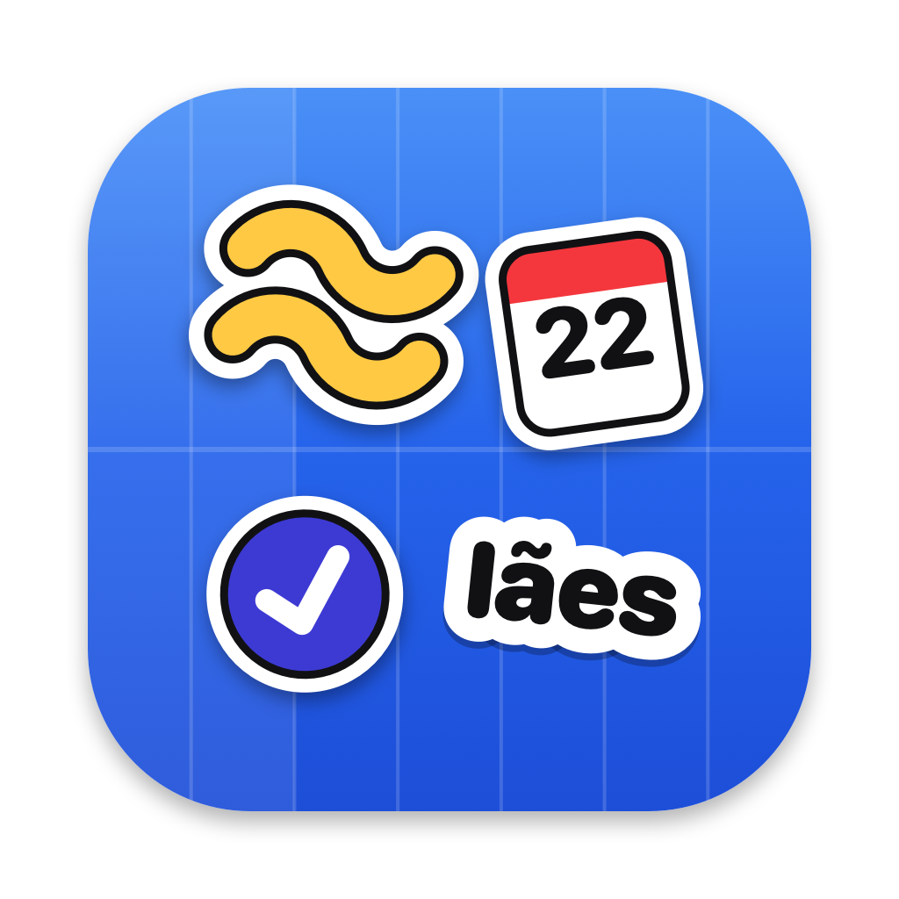
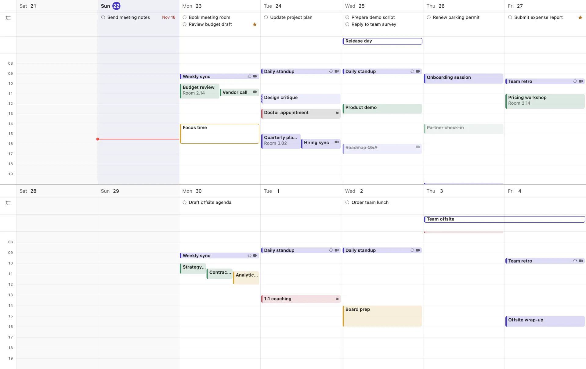

<p align="center">
  
</p>

<h1 align="center">lães <sub>(say “lanes”)</sub></h1>

<p align="center">
  Your Microsoft 365 calendar, To Do tasks and notes, two weeks at a time, on Mac and iPhone.<br>
  With a built-in connection for the AI tools on your Mac.
</p>

<p align="center">
  <a href="https://laesapp.com/">Website</a> ·
  <a href="https://laesapp.com/help/">Help</a> ·
  <a href="https://github.com/jkrenge/laes/issues/new/choose">Report a bug</a>
</p>



The tilde in the name is two lanes, ≈: this week and the next, one above the other.

## What it does

- **Two weeks on one screen.** Saturday to Friday, this week above the next. Each day shows its tasks on top and its meetings below; all-day events run across the top.
- **Tasks where you plan them.** Microsoft To Do lists, Planned, Important. Drag a task onto a day to give it a due date, or into the calendar to block an hour for it. Type "Call mom tomorrow star" and it lands tomorrow, starred.
- **Notes for your meetings.** Markdown files in a OneDrive folder only lães uses, linked to the meeting they belong to.
- **A private group.** Pick the calendar categories and task lists you'd rather not show while sharing your screen; one button hides or shows them all.
- **Works offline.** Task changes are queued and sent when you're back online. The iPhone also syncs in the background.
- **An agent on your Mac.** An MCP server lets AI tools such as Claude Code read and change your calendar, tasks and notes while lães is open. It listens only on this Mac and needs a token kept in your Keychain.
- **Your icon.** Arrange the sticker icon your way in Settings › App Icon.

## Requirements

- macOS 15 or later, iOS 18 or later
- A Microsoft work, school or personal account with Outlook calendar and Microsoft To Do. Notes need OneDrive.
- Some organisations only let staff sign in to apps an administrator has approved. If sign-in is blocked, ask your Microsoft 365 admin to approve lães.

## Build it yourself

You need Xcode 26 or later and [XcodeGen](https://github.com/yonaskolb/XcodeGen) (`brew install xcodegen`). The Xcode project isn't checked in; it's generated from `project.yml`.

```bash
git clone https://github.com/jkrenge/laes.git
cd laes
xcodegen generate
open Laes.xcodeproj
```

- Set your own Apple team in `project.yml` (`DEVELOPMENT_TEAM`) and run `xcodegen generate` again.
- Schemes: **Laes** is the Mac app, **LaesiOS** the iPhone and iPad app.
- Tests run on the Mac: `xcodebuild -project Laes.xcodeproj -scheme Laes -destination 'platform=macOS' test`
- Launch the Mac app with `-demo` to see sample data without signing in.

### Microsoft sign-in

lães signs in with OAuth 2.0 and PKCE as a public client, so there is no client secret. The client ID in `Laes/Graph/AuthService.swift` belongs to the author's Microsoft Entra registration and works for any account. To use your own, register a multi-tenant app in Entra with:

- Platform: mobile and desktop, redirect URI `laes://auth`
- Delegated permissions: `User.Read`, `Calendars.ReadWrite`, `Tasks.ReadWrite`, `MailboxSettings.Read`, `Files.ReadWrite.AppFolder`, `offline_access`

Then replace `clientID`.

### App icon and stickers

`swift Scripts/make-icon.swift` (run from the repository root) draws the app icon, all 143 sticker designs the iPhone can switch between, and the sticker images the editor uses. Run it again after changing a sticker.

## Project layout

| Path | What's there |
|---|---|
| `Laes/` | The shared app: models, sync, Microsoft Graph client, offline queue, MCP server, and the Mac views |
| `Laes/Views/` | SwiftUI views; most are shared, a few are Mac only |
| `LaesiOS/` | The iPhone and iPad screens and app entry point |
| `LaesTests/` | Unit tests (Swift Testing) |
| `Scripts/` | The icon generator |
| `site/` | The website, deployed to GitHub Pages |

## Privacy

Your calendar, tasks and notes go only to Microsoft, with your own sign-in. They are cached on your device for offline use, the sign-in and the AI token are kept in your Keychain, and none of it is sent anywhere else. The app sends crash reports, anonymous usage counts and feedback to the developer's own server through [BoringKit](https://github.com/jkrenge/boring-ass-app-kit); a build signed by another Apple team sends nothing, because that server only accepts the author's team. Signing out removes the local copy.

## Contributing and security

Bug reports and ideas are welcome. See [CONTRIBUTING.md](CONTRIBUTING.md). Please report security issues privately, as described in [SECURITY.md](SECURITY.md).

## License

[MIT](LICENSE). Build it, change it, share it.

lães is an independent app and isn't affiliated with or endorsed by Microsoft. Microsoft 365, Outlook, OneDrive and Microsoft To Do are trademarks of the Microsoft group of companies.
